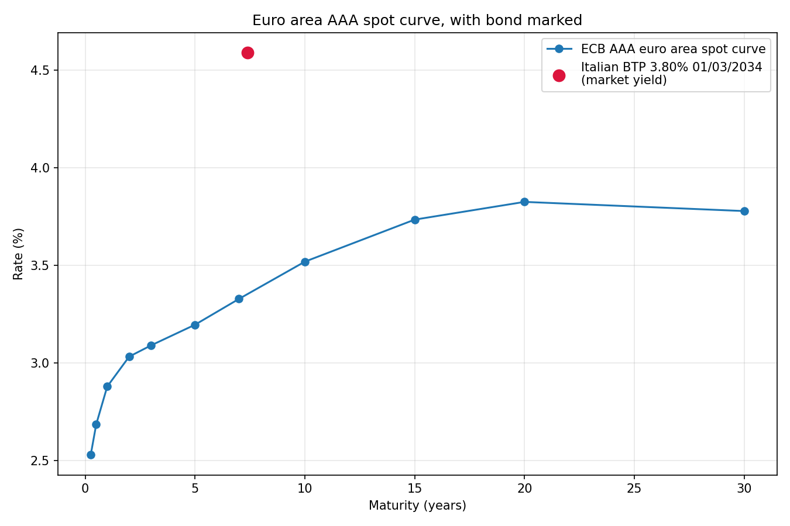
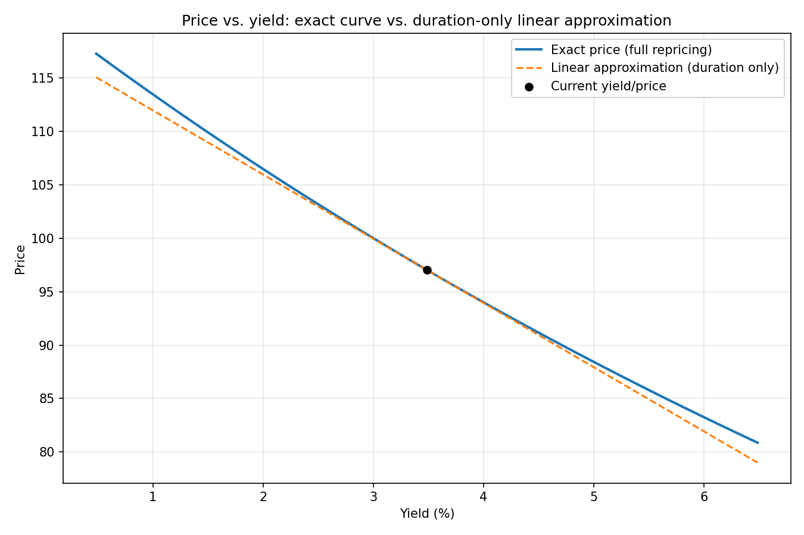

# Fixed income kit: bond pricing, duration, convexity

Prices sovereign bonds against a live ECB yield curve, computes Macaulay
and modified duration, convexity, DV01, and draws the picture that
actually explains what convexity means: exact price-vs-yield vs. the
straight-line approximation duration gives you.




## Why this project

Duration tells you the slope of price vs. yield at one point. Convexity
tells you how wrong the slope-only answer gets as the yield move grows.
That gap — a straight line vs. a curve — is the whole point of this
project, and it's the kind of thing that's much clearer drawn than stated.

## What it does

1. Fetches the ECB's euro area AAA government bond yield curve (public,
   no key, via the ECB Statistical Data Warehouse)
   ([`src/curve.py`](src/curve.py)).
2. Prices a bond given a yield, or inverts price for yield, via
   [`src/bond_math.py`](src/bond_math.py) — also Macaulay/modified
   duration, convexity, DV01.
3. Plots the curve with a bond's market yield marked on it, and the
   price-vs-yield curve against its duration-only linear approximation
   ([`src/plotting.py`](src/plotting.py)).

Run it yourself:

```bash
pip install -r requirements.txt
python -m src.build_report
```

## Acceptance check: does the model reproduce real market prices?

Three real sovereign bonds — a German Bund, a French OAT, an Italian BTP —
with coupon, maturity, market yield and market price captured from a public
source (investing.com, 2026-10-09; URLs and exact figures in
[`tests/fixtures/control_bonds.py`](tests/fixtures/control_bonds.py)).
`tests/test_control_bonds.py` feeds each bond's quoted market yield into
`price_from_yield` and checks the result lands within **2 price points**
of the quoted market price. All three pass. The tolerance is wide on
purpose — see below.

## Known limitations (declared, not hidden)

- **No exact coupon date alignment.** The model assumes the next cashflow
  lands exactly `1/freq` years from the valuation date. Real bonds pay on
  a fixed calendar date (e.g. 15 August), so the first coupon period from
  any given valuation date is usually a few weeks short or long of a full
  period. For the three control bonds (~7-year maturities) this alone
  accounts for roughly 0.6-1.6 price points of the gap between my
  calculated price and the real quoted price — which is why the
  acceptance tolerance is 2 points, not 1 cent like the implied-vol
  project. A real bond pricer would track the actual coupon schedule and
  accrued interest (clean vs. dirty price); this one doesn't.
- **Not a swap/€STR curve.** The brief mentions €STR/swap; what's
  actually used is the ECB's own published AAA government bond spot curve
  (Svensson model, continuous compounding). I went with this because it's
  a clean, directly-published public series with no bootstrapping of my
  own required — €STR + swap spreads would need assembling a curve from
  several separate instruments, which is a bigger, different project. The
  AAA curve plays the same role here (a risk-free-ish discounting curve)
  but isn't what the brief named.
- **ACT/365.25, not ACT/ACT or 30/360.** Same category of simplification
  as the coupon-date point above — fine at this tolerance, not what a
  real desk would use for accrued interest.
- **No day-count-specific accrued interest / clean-dirty price
  distinction.** The "price" everywhere in this project is effectively
  the model's own internal convention, not a specific market clean or
  dirty price convention.

## What I found while building this

`bond_math.py`'s `cashflow_times()` originally used `round()` to compute
how many coupon periods remain. `round(0.5)` hits Python's round-half-to-
even (banker's rounding) and returns `0`, not `1` — so a 6-month bond with
annual coupons silently looked like it had zero cashflows left. A test
for exactly this edge case (`years_to_maturity=0.5, freq=1`) caught it;
fixed by switching to `math.ceil`.

The first attempt at the convexity plot used an arbitrary yield range
without checking it against the actual curve shape — it's now centered on
the bond's own market yield with a ±300bp range, which is wide enough to
show the curvature clearly without the plot looking like a straight line
(too narrow a range) or diverging absurdly (too wide, past where the
bond's price would hit zero).

## Tests

```bash
python -m pytest tests/ -v
```

23 tests: bond pricing against hand-computed and textbook values, the
par-at-coupon-equals-yield identity, zero-coupon duration = maturity,
yield round-tripping, the rounding bug above, the ECB curve interpolation
and extrapolation behavior, the 3-bond market acceptance check, and a
geometric check that the exact price-yield curve never falls below its
own linear tangent (the definition of positive convexity, verified
directly from the plotted data).
